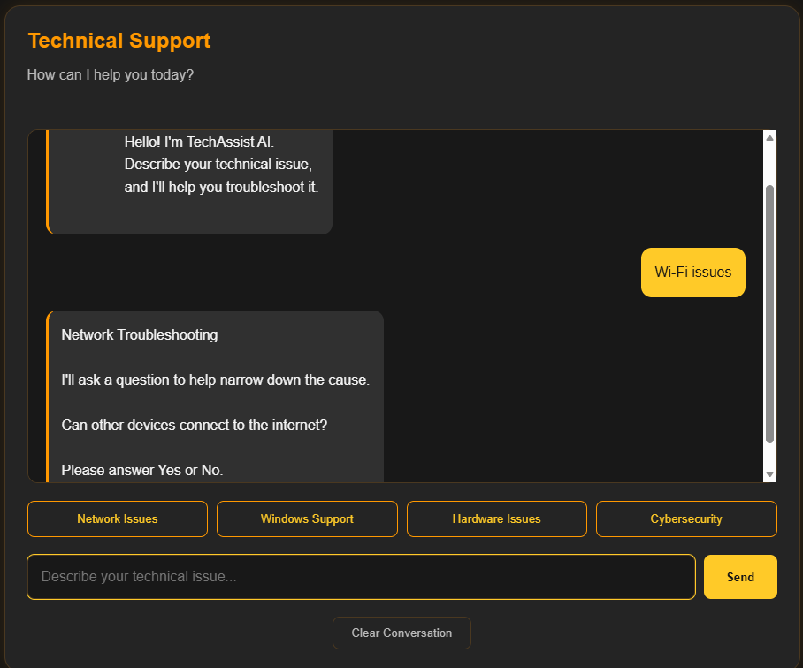
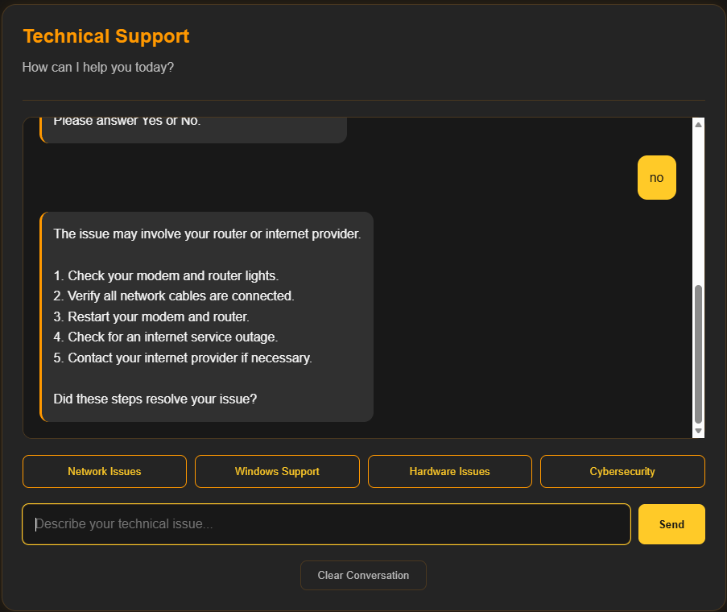
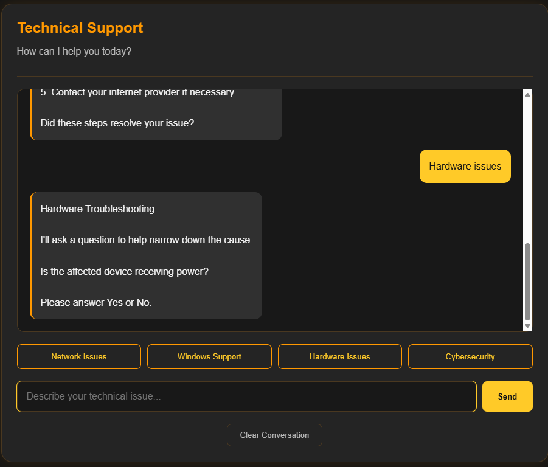

# TechAssist AI

## Project Overview

TechAssist AI is an AI-assisted technical support
application developed for the COSC 4272 Senior
Seminar course at Lamar University.

The application helps users diagnose and resolve
common computer, networking, software, hardware,
and cybersecurity problems through an interactive
troubleshooting interface.

## Project Objectives

- Provide accessible technical support.
- Demonstrate web development skills.
- Implement contextual conversation handling.
- Apply conditional decision-making logic.
- Demonstrate AI-assisted software development.

## Features

- Interactive chatbot interface
- Keyword-based problem recognition
- Contextual conversation handling
- Diagnostic follow-up questions
- Step-by-step troubleshooting instructions
- Issue resolution verification
- Technical support escalation
- Responsive desktop and mobile design
- Clear conversation functionality

## Technologies Used

- HTML5
- CSS3
- JavaScript
- ChatGPT
- GitHub
- GitHub Pages

## How the Application Works

The application uses a rule-based expert system
and a predefined troubleshooting knowledge base.

JavaScript analyzes user input to identify the
most relevant technical problem. The application
then asks diagnostic questions and provides
conditional troubleshooting instructions based
on the user's responses.

Conversation state allows the application to
remember the current troubleshooting category
and determine whether the issue was resolved.

## Supported Troubleshooting Categories

- Networking and Wi-Fi
- Computer performance
- Windows operating system
- Computer hardware
- Cybersecurity
- Account recovery
- Printers
- Software applications

## Project Structure

    ai-assistant/
    ├── README.md
    ├── index.html
    ├── style.css
    ├── script.js
    └── screenshots/

## Screenshots

### Network Diagnosis

### Network Solution

### Hardware Troubleshooting

## Testing

The application was tested through its deployed
GitHub Pages website.

Testing demonstrated:

- Network issue recognition
- Diagnostic follow-up questions
- Context-based troubleshooting responses
- Hardware issue recognition
- Switching between troubleshooting categories

## AI-Assisted Development

ChatGPT was used extensively during development
to assist with project planning, interface design,
source code generation, troubleshooting logic,
and documentation.

The developer implemented the generated code,
deployed the application, and performed
functional testing.

## Limitations

The application uses predefined rules rather than
a generative AI language model.

It does not require an external API, backend
server, or paid AI subscription.

The application provides general troubleshooting
guidance and does not replace professional
technical support.

## Future Improvements

- Generative AI model integration
- Expanded troubleshooting knowledge base
- Conversation export functionality
- Additional operating system support
- More advanced diagnostic questions

## Live Application

[Launch TechAssist AI](https://oreo107-r.github.io/github-portfolio/projects/ai-assistant/)

## Developer

Orion Medrano

Bachelor of Science in Computer Information Systems

Lamar University

COSC 4272 Senior Seminar

Expected Graduation: May 2027
